# Battery Manufacturing Quality Intelligence

This is an independent academic portfolio project using public or synthetic data. It is not affiliated with Tesla, Bio-Rad, or any battery manufacturer.

An end-to-end Python system for predicting conceptual lithium-ion module inspection failures, monitoring unusual process conditions, investigating batch risk, and testing constrained process recommendations against a synthetic simulator. All measurements, labels, bounds and results are simulated. No production deployment or physical safety validation is claimed.

## Dashboard Preview

Actual screenshots of the locally running Streamlit application, captured in Chrome at **1600 × 1400**. Every chart and KPI uses the existing synthetic experiment outputs. These images demonstrate the application; they do not establish real-world manufacturing improvements.

### Manufacturing Quality Overview

Production volume, pass rate, defect rate, first-pass yield, and quality trends across batches and equipment.

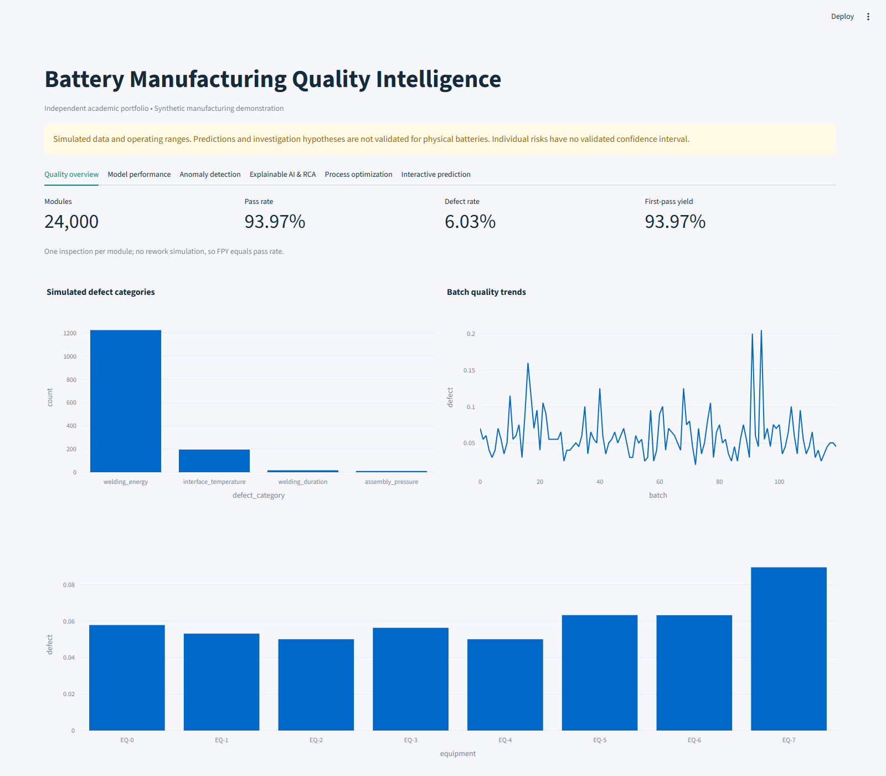

### ML Model Performance

Compare all four classifiers, inspect LightGBM precision, recall and PR-AUC, and explore the held-out confusion matrix and precision–recall curve at the selected threshold.

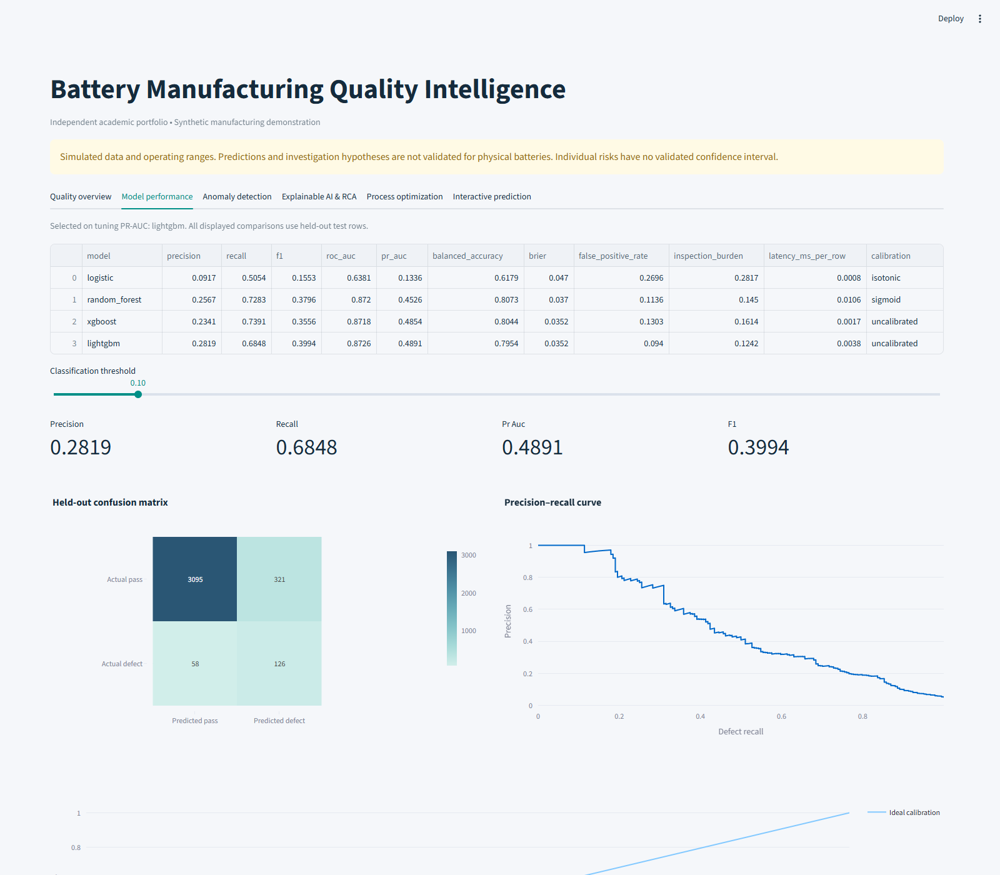

### Anomaly Detection

Isolation Forest alert precision and recall, score distributions, and equipment- and batch-level monitoring. Anomalies and defects are distinct outcomes.

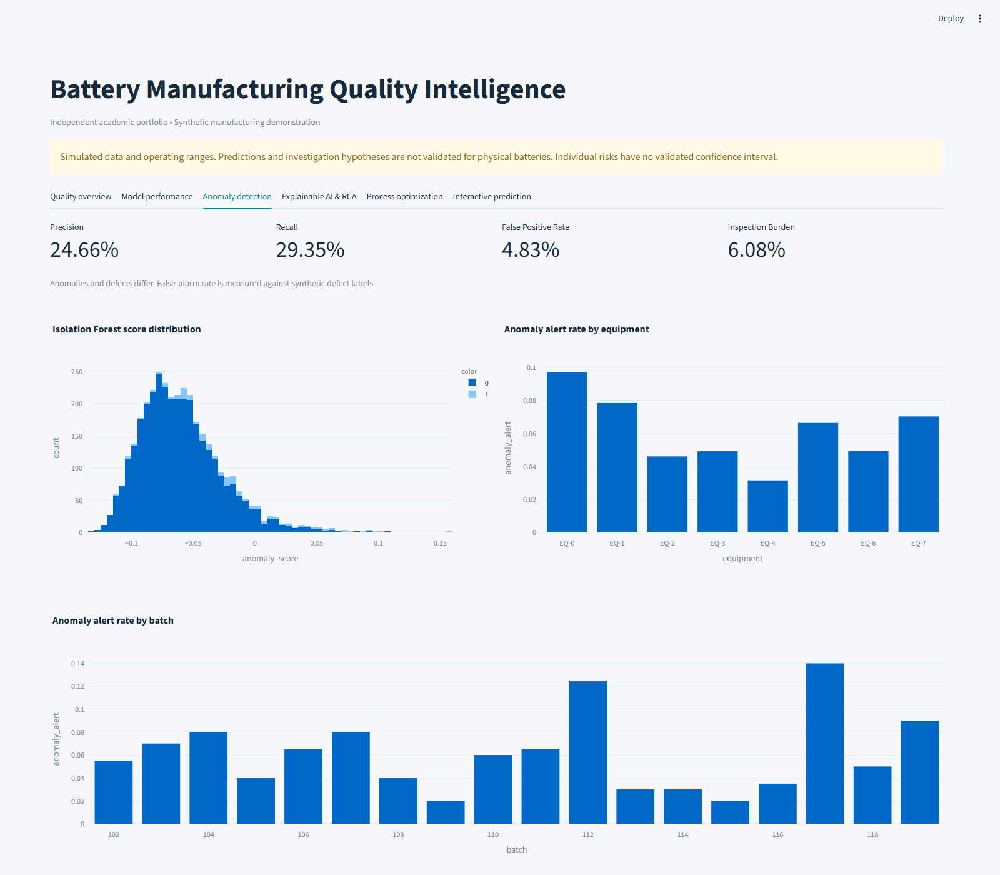

### Explainable AI & Root Cause Investigation

Global SHAP importance, individual risk factors, and batches prioritized for investigation. Associations support hypotheses rather than confirmed root causes.

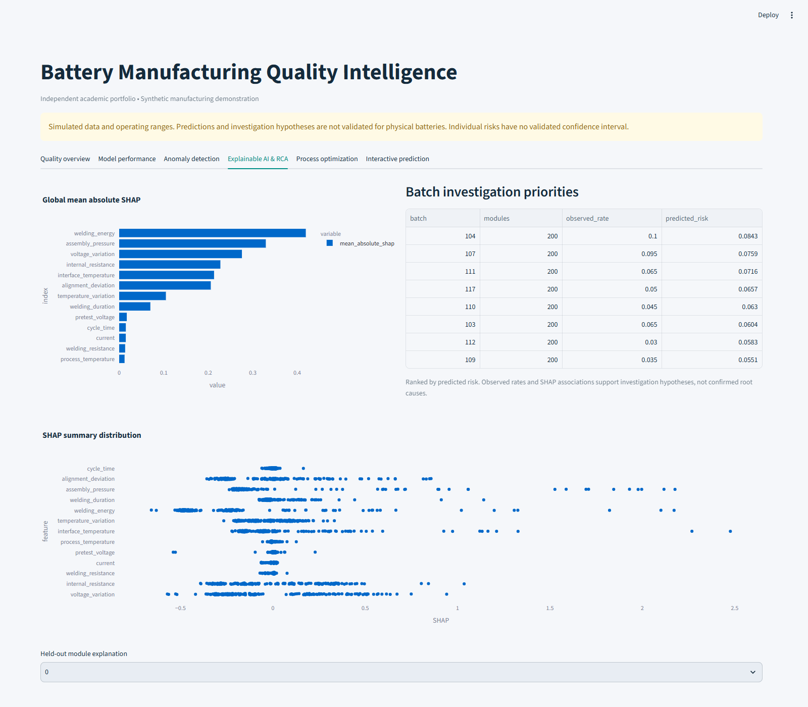

### Process Optimization

Compare baseline, random-search and constrained-search probabilities, with simulated process settings, solver outcomes and constraint validation.

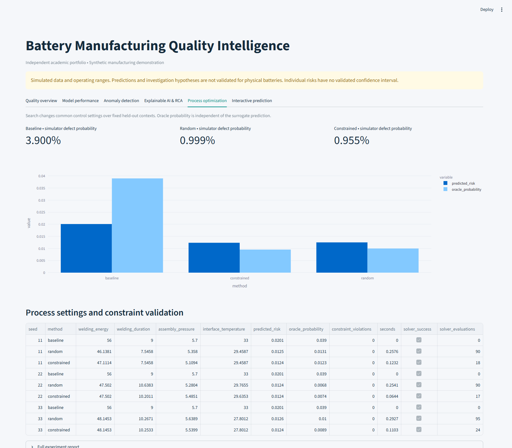

### Interactive Quality Prediction

Adjust process measurements and inspect the resulting defect probability, pass/fail prediction, risk band and SHAP contributions.

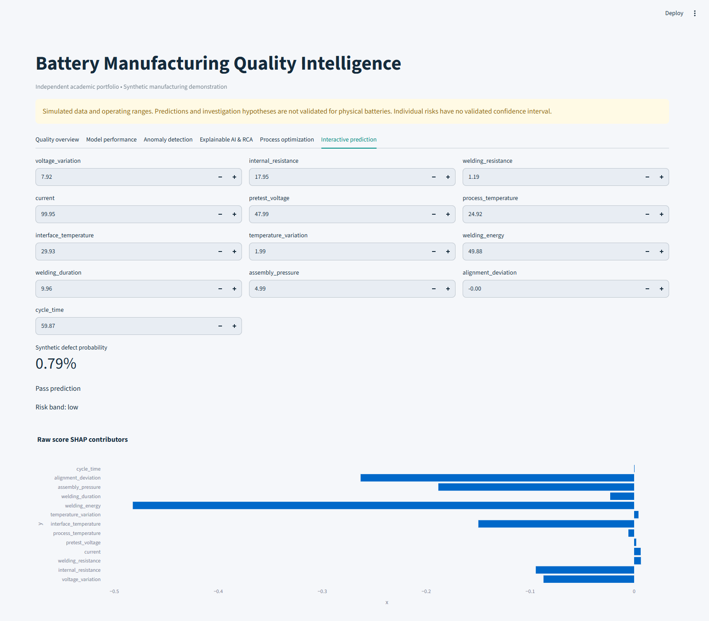

<details>
<summary>Additional views: calibration, process deviations, and batch investigation</summary>

Calibration analysis compares predicted risk with observed held-out defect rates and lists the evaluated calibration methods.

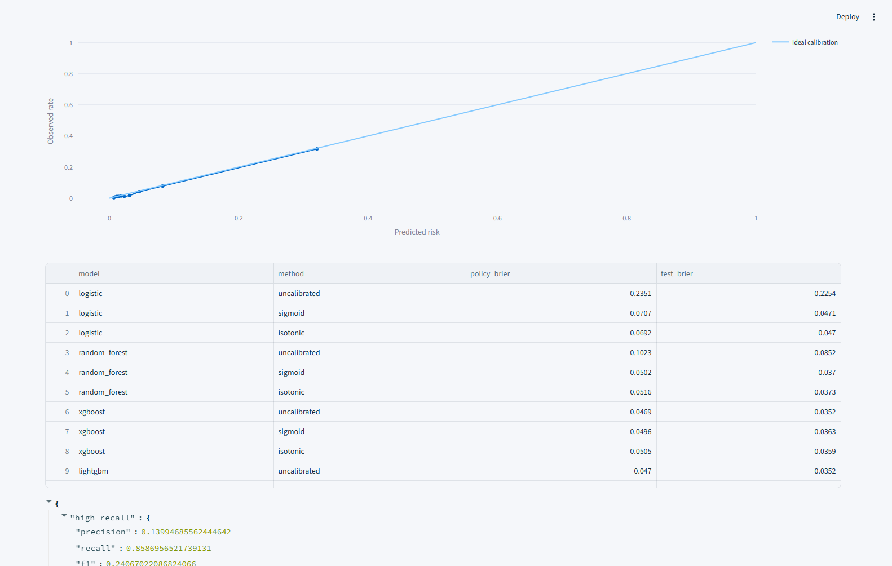

Process measurement comparisons and supervised-versus-anomaly alerts provide additional monitoring context.

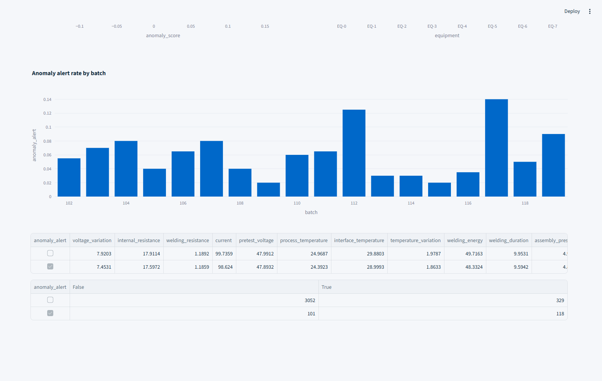

The downloadable batch report documents observed rates, process deviations and potential contributing factors.

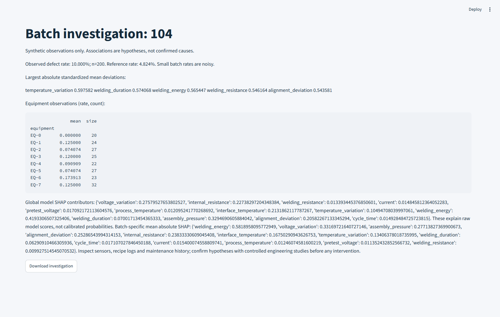

</details>

Continue to [setup](#setup-and-reproduce), [methodology](#methodology), [verified results](#actual-experiment-outputs), or [limitations](#limitations-and-next-steps).

## System architecture

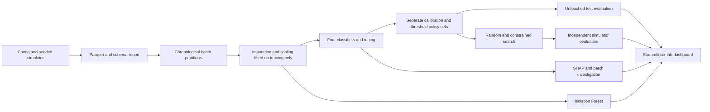

## Setup and reproduce

Python 3.11+ (validated environment recorded in `reports/results.json`). PowerShell:

```powershell
python -m venv .venv
.\.venv\Scripts\Activate.ps1
python -m pip install -e '.[dev]'
python scripts/run_pipeline.py --seed 42
python -m streamlit run app/dashboard.py
python -m pytest -q
python -m ruff check .
```

On Linux/macOS activate with `source .venv/bin/activate`. Run commands from the repository root. Default configuration generates 24,000 modules. Override `--records`, `--seed`, `--config`, or `--output`. The dashboard reads root-level outputs; use the default output for interactive use. Re-running replaces generated artifacts. Runtime is machine dependent. No network or paid API is needed after dependency installation. Only load trusted local joblib artifacts. Exact installed versions are provided in `requirements-lock.txt` after verification.

## Dataset selection and manufacturing assumptions

A targeted public-data investigation did not identify a downloadable dataset meeting this project's combination of module process measurements, temporal batch metadata, and end-of-line labels. This is not an exhaustive claim that no such data exists. [Laser-weld inspection research](https://www.mdpi.com/1424-8220/23/21/8894) uses labeled weld images; [module inspection research](https://doi.org/10.3390/s25247613) addresses image segmentation and defect localization. These are different prediction tasks. Battery cycling/degradation data is not substituted for manufacturing quality labels.

The simulator therefore represents incoming inspection, cell grouping, assembly, welding, thermal interface integration and final inspection. All modules proceed to one end-of-line inspection; no rework, repair, or scrap routing is simulated. Consequently first-pass yield equals pass rate. Defect categories are illustrative dominant control deviations rather than verified physical diagnoses.

| Stage | Pre-inspection measurements | Illustrative center / scale |
|---|---|---|
| Incoming / sorting | Cell voltage spread, internal resistance | 8 / 2 mV; 18 / 2 mΩ |
| Assembly | Pressure, alignment, cycle time | 5 / 0.7 arbitrary pressure units; 0 / 0.2 mm; 60 / 5 s |
| Welding | Energy, duration, connection resistance, in-process current | 50 / 7 J; 10 / 1.2 ms; 1.2 / 0.2 mΩ; 100 / 5 A |
| Thermal integration | Process temperature, interface temperature, temperature spread | 25 / 3 °C; 30 / 3 °C; 2 / 0.5 °C |
| Pre-inspection electrical check | Pretest voltage | 48 / 0.3 V |
| Final inspection (excluded) | Defect, category, simulator probability | Outcome / diagnostic-only |

These units and numerical values are arbitrary conceptual assumptions, not battery specifications. Measurements are Gaussian with independent sensor variation (0.8 nominal scales), a shared module factor (0.4), a batch factor (0.25), and equipment offsets (0.07 per equipment index). Weld duration is correlated with energy. Sensor dropout is 0.3% per feature. Metadata includes unique module ID, 200-module batches, eight equipment IDs, four stations, three shifts and minute-spaced timestamps.

Latent failure log-odds combine squared energy, pressure and interface-temperature deviations, absolute alignment, voltage spread, internal resistance, temperature spread and a nonlinear energy/duration interaction. The intercept is solved once so mean latent failure probability matches the configured 6%; Bernoulli sampling determines labels. Dropout is added afterward. No measurement clipping hides outliers. These choices create learnable nonlinear associations and random defects; they do not simulate electrochemistry. Parameters and the complete formula are in `src/quality_intelligence/data.py`.

## Methodology

Data validation rejects empty inputs, missing columns, duplicate modules, nonbinary labels, infinities and excessive missingness; a report counts missing values and nominal-scale outliers. Parquet data is hashed in the version manifest. Explicit feature allowlisting excludes IDs, timestamps, categories, simulator probability and final inspection outcomes. Equipment identifiers are retained for investigation, not prediction; unseen equipment identifiers therefore do not break inference. This does not establish generalization to unseen equipment physics.

Five chronological batch-disjoint partitions use 50/15/10/10/15% of batches for training, tuning, calibration, policy selection and test. Equipment can recur between periods, representing future batches on existing equipment. Imputation and standardization fit only training rows. Four families (Logistic Regression, Random Forest, XGBoost, LightGBM) each test two configurations. Tree models learn nonlinear feature combinations; the logistic baseline uses standardized original measurements. Balanced class weights are used for logistic regression and random forest. No oversampling crosses partitions.

The best family is selected by tuning average precision (reported as PR-AUC). Sigmoid mapping of raw probabilities and isotonic calibration are fitted on the calibration set; the policy set chooses among those and the uncalibrated baseline by Brier score. The sigmoid is fitted directly on raw probability, not log-odds. Keeping the uncalibrated option prevents forcing calibration that worsens validation Brier score. Policy-set threshold search compares 90% recall, <=2% false-positive rate and a configurable 15:1 missed-defect:false-reject cost. These targets are validation objectives and may not hold on test data. Test evaluation reports precision, recall, F1, ROC-AUC, average precision, balanced accuracy, Brier, confusion matrices, false-positive rate, inspection fraction and amortized batch inference latency. Calibration selection and threshold selection share a policy set, so estimates from that set are optimistic; the final test stays separate.

## Actual experiment outputs

Verified seed-42 run: **24,000 modules**, **6.029% observed defects**, **93.971% first-pass yield**; final test contains 3,600 modules and 184 defects. These are synthetic experiment results.

| Model | Precision | Recall | F1 | ROC-AUC | PR-AUC (AP) | Brier |
|---|---:|---:|---:|---:|---:|---:|
| Logistic regression | 0.0917 | 0.5054 | 0.1553 | 0.6381 | 0.1336 | 0.04704 |
| Random forest | 0.2567 | 0.7283 | 0.3796 | 0.8720 | 0.4526 | 0.03704 |
| XGBoost | 0.2341 | 0.7391 | 0.3556 | 0.8718 | 0.4854 | 0.03518 |
| LightGBM (selected) | 0.2819 | 0.6848 | 0.3994 | 0.8726 | 0.4891 | 0.03517 |

Each row uses its policy-set cost threshold. Isotonic calibration reduced logistic test Brier from 0.22541 to 0.04704; sigmoid reduced random forest from 0.08516 to 0.03704. Validation retained uncalibrated probabilities for both boosting models. LightGBM isotonic test Brier was 0.03514, but choosing it based on test results would leak test information. Calibration does not guarantee improved discrimination or validated uncertainty.

LightGBM's balanced threshold 0.095 inspects 12.42% of test modules, falsely flags 9.40% of passing modules and misses 58 of 184 defects. The high-recall policy reaches 85.87% test recall (below its 90% validation objective), inspects 31.36% and misses 26 defects. The low-false-reject policy misses 123 defects. Isolation Forest achieves 24.66% precision, 29.35% recall and 4.83% false alarms. Batch 104 has 10.0% observed defects versus 4.824% in other held-out batches; the investigation report includes process deviations and batch-specific SHAP hypotheses.

Mean independent simulator probability is 3.900% for the chosen off-center baseline, 0.999% for random search and 0.955% for constrained search. Constrained-search standard deviation is 0.252 percentage points; approximate 95% mean interval is 0.330–1.580% across three search seeds. All returned settings satisfy simulated constraints. Constrained search is slightly worse than random search on simulator probability for seed 22 despite a lower surrogate score; the small difference in overall means does not establish superiority over random search.

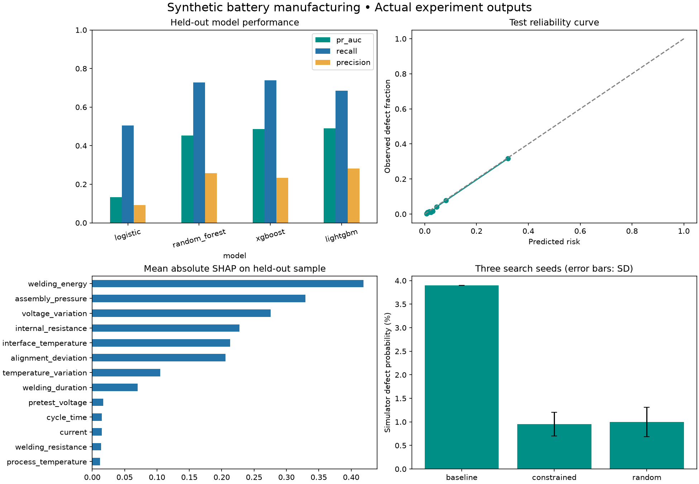

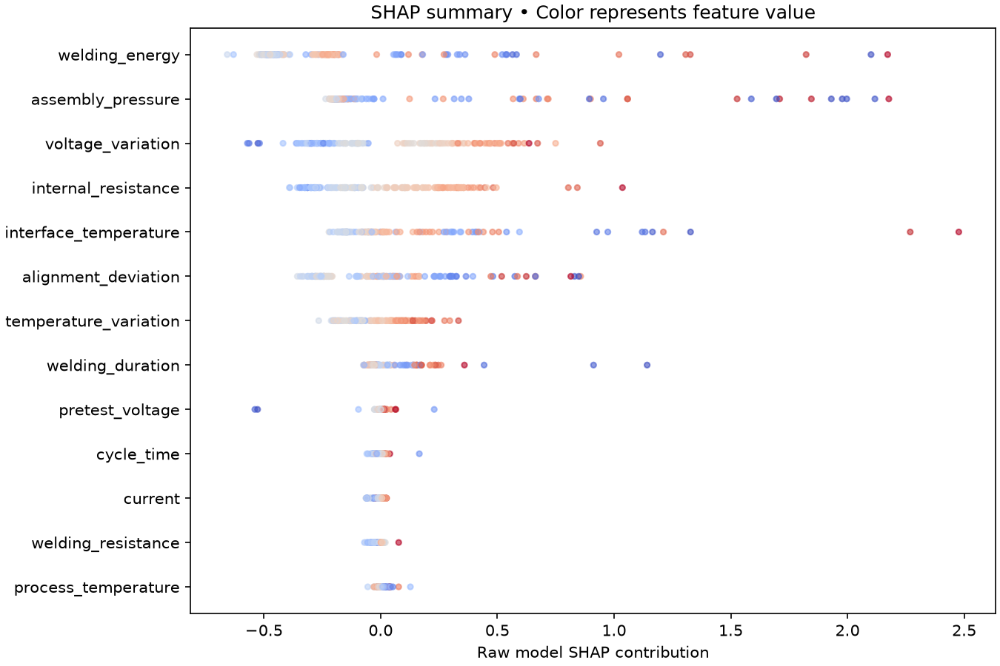

These two figures are exported experiment plots. Actual dashboard screenshots appear in [Dashboard Preview](#dashboard-preview). Capture used the installed Chrome browser through its local automation interface because the integrated browser host was unavailable. The dashboard was also verified with Streamlit AppTest, including threshold interaction and missing-artifact state, and a running server with HTTP health status 200.

See [evaluated metrics and optimization results](reports/evaluation.md), [complete machine-readable results](reports/results.json), [calibration comparisons](reports/calibration.csv), [tuning trials](reports/tuning.csv), and [batch investigation](reports/investigation.md). These files are generated by real execution; metrics are never embedded in dashboard code.

Isolation Forest uses training-fitted imputation/scaling and 6% contamination. Evaluation treats defect labels as a reference for alert precision, recall and false-alarm rate while acknowledging that anomalous conditions need not cause defects. It may expose previously unseen deviations, but synthetic defect-label evaluation does not validate novelty detection. The dashboard compares alerts with supervised predictions and shows score distributions and equipment/batch alerts.

SHAP explains the selected raw classifier, with global mean absolute importance, summary distributions and individual contributions on up to 160 held-out rows. It does not explain the subsequent probability calibration. Scores use the family-specific SHAP output scale. The simulator includes a weld energy/duration interaction; formal SHAP interaction decomposition is deferred. Batch RCA ranks predicted risk, compares observed rates and standardized process deviations against other held-out batches, and reports equipment counts. Outputs are investigation hypotheses; small batches and observational associations cannot confirm causes.

Optimization adjusts energy [35,65], duration [7,13], pressure [3.5,6.5], and interface temperature [24,36], with an energy/duration constraint [3.5,6.5]. These are simulation ranges only. A deliberately off-center baseline [56,9,5.7,33] is compared with random search and COBYLA initialized at the best feasible random point. Thus constrained search has an additional computational budget; timing and solver evaluations are reported, and solver failure is retained. Feasibility is rechecked and infeasible solutions fall back to the feasible random result. Three fixed search seeds use held-out contexts. The structural simulator evaluates expected defect probability independently of the recommending model; oracle values never guide search. This is a shared-simulator validation, not external validation. The reported Student-t intervals describe search variability only, with three seeds and fixed contexts. Improvements are relative to the chosen synthetic baseline and may be negative.

## Dashboard and repository

Six tabs cover quality KPIs and category/batch/equipment trends; held-out model comparisons, threshold controls, calibration and PR curves; anomaly monitoring; global/individual SHAP and downloadable investigations; constrained optimization; and adjustable process predictions. Missing artifacts show reproduction instructions. Predictions carry synthetic-data and extrapolation caveats. Actual dashboard screenshots are saved under `assets/` and embedded above.

Verified checks: `python -m pytest -q` — **15 passed**, with five upstream SHAP/LightGBM output-format warnings; `python -m ruff check .` — passed; `python -m pip check` — passed. Installation via `python -m pip install -e '.[dev]'` succeeded. CI is configured; a hosted GitHub Actions run has not been executed.

To repeat the full reproducibility check and export figures:

```powershell
python scripts/run_pipeline.py --seed 42 --output data/reproduction
python scripts/compare_runs.py . data/reproduction
python scripts/plot_results.py
```

The independent rerun matched the dataset hash, model selection and thresholds exactly. Predicted probabilities and scientific metrics matched within 1e-12; random-forest parallel summation differed by at most 5.55e-16. Latencies are excluded from comparison. Cross-platform binary identity is not promised. Set `QUALITY_ARTIFACT_ROOT` to use another artifact directory in the dashboard.

| Location | Purpose |
|---|---|
| `src/quality_intelligence/` | Simulator, validation, modeling, calibration, monitoring, explanations, optimization, orchestration |
| `configs/` | Reproducible data and cost settings |
| `scripts/run_pipeline.py` | Complete pipeline CLI |
| `app/dashboard.py` | Interactive Streamlit application |
| `tests/` | Behavioral, integration and dashboard smoke tests |
| `reports/` | Small reviewable evaluation artifacts |
| `data/`, `models/` | Ignored regenerated data and trusted local model artifacts |
| `.github/workflows/ci.yml` | Installation, Ruff and pytest |

## Limitations and next steps

Synthetic relationships dominate measured performance. No factory yield gain, causal root cause, validated uncertainty interval or safe recipe is demonstrated. Contexts are fixed when optimizing controls; changing physical recipes may change downstream measurements in ways this simulator omits. Data drift, temporal deterioration, sensor calibration errors, real process constraints, cost estimation and prospective safety validation require real engineering evidence. Next steps include learning curves, independent simulators, equipment holdout studies, richer feature interactions, bootstrap calibration uncertainty and controlled pilot validation with an authorized dataset.

No license has been added. No commit or push is performed by the pipeline.
